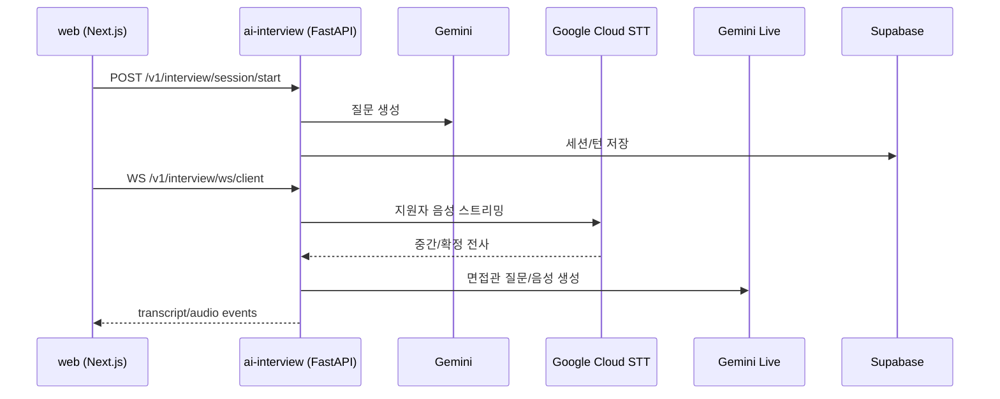

# Debut AI Interview API (FastAPI)

AI 면접 질문 생성, 세션 저장, 음성 WebSocket(STT/TTS) 처리를 담당하는 백엔드입니다.

## 구조



## 주요 엔드포인트 (2026-07 실측)

**공통**: `GET /health` · `GET /docs`(OpenAPI)

**면접 (`/v1/interview`)**
- 파싱: `POST /parse-job` · `POST /parse-resume` — 웹 BFF가 공고/이력서 등록 시 프록시로 호출
- 세션: `POST /session/start` · `POST /sessions/{id}/prepare-opening` · `POST /sessions/{id}/complete` · `GET /sessions` · `GET /sessions/{id}`
- 리포트: `GET /sessions/{id}/report-status`(폴링) · `POST /sessions/{id}/retry-report`
- 음성: `WS /v1/interview/ws/client` (지원자 자막: Google Cloud STT, 면접관 음성: Gemini Live, `ws_runtime`)
- 화상: `POST /livekit/token`
- 포트폴리오 디펜스: `POST /portfolio/analyze-public-repo` · `POST /portfolio/session/start` · `POST /portfolio/chat`
- 기타: `POST /chat` · `POST /analyze` · `GET /health`

**이력서 (`/v1/resume`)**: `POST /normalize`

**관리 (`/admin`)**: `GET /admin/health` 등

> 참고: 웹 BFF의 면접 텍스트 채팅 라우트(`web/app/api/interview/chat`)는 410으로 폐기되어 음성 면접이 기본입니다. 세션 목록/상세 조회는 BFF가 FastAPI를 거치지 않고 Supabase를 직접 읽는 특례가 있습니다 (소유권 검사 포함).

## 환경변수

| 키 | 필수 | 설명 |
|---|---|---|
| `DATABASE_URL` | 예 | Postgres 연결 문자열 |
| `GEMINI_API_KEY` | 예 | 질문 생성/분석 LLM |
| `GEMINI_MODEL` | 아니오 | 기본 `gemini-2.5-flash` |
| `GEMINI_LIVE_STT_MODEL` | 아니오 | 기본 `gemini-2.5-flash-native-audio-latest` |
| `GEMINI_TTS_MODEL` | 아니오 | 기본 `gemini-2.5-flash-preview-tts` |
| `GEMINI_LIVE_TTS_MODEL` | 아니오 | TTS fallback용 Live 모델(기본 `gemini-2.5-flash-native-audio-latest`) |
| `GEMINI_LIVE_TTS_VOICE` | 아니오 | 기본 `Kore` |
| `VOICE_PARALLEL_STT_ENABLED` | 아니오 | 기본 `true`; Google Cloud STT로 지원자 발화를 실시간 자막 처리 |
| `VOICE_LIVE_INPUT_STREAMING_ENABLED` | 아니오 | 기본 `false`; Vertex native-audio의 질문 선생성을 막고 답변은 전송 시 처리 |
| `GITHUB_TOKEN` | 권장 | GitHub API rate limit 회피 및 공개 레포 분석 안정화 |
| `CORS_ORIGINS` | 예 | 웹 도메인 목록(콤마 구분) |
| `LIVEKIT_URL` | 선택 | 라이브킷 연동 시 |
| `LIVEKIT_API_KEY` | 선택 | 라이브킷 연동 시 |
| `LIVEKIT_API_SECRET` | 선택 | 라이브킷 연동 시 |
| `VOICE_VAD_THRESHOLD` | 아니오 | 기본 `0.015` |
| `VOICE_VAD_SILENCE_MS` | 아니오 | 기본 `700` |
| `VOICE_MIN_SPEECH_MS` | 아니오 | 기본 `350` |
| `VOICE_MAX_SEGMENT_MS` | 아니오 | 기본 `10000` |

## 로컬 실행

```bash
cd ai-interview
cp .env.example .env
uv sync
uv run uvicorn app.main:app --reload --port 8001
```

확인:

```bash
curl http://localhost:8001/health
```

## Render 배포 설정

- Root Directory: `ai-interview`
- Runtime: `Python`
- Build Command: `uv sync --frozen --no-dev`
- Start Command: `uv run --frozen --no-dev --no-sync uvicorn app.main:app --host 0.0.0.0 --port $PORT`

배포 후 확인:

- `https://<service>.onrender.com/health`
- `https://<service>.onrender.com/docs`

## 개발 메모

### 시연 질문 음성

`app/demo_audio/`에는 오프닝·고정 질문·종료 대사의 음성을 압축 PCM으로 포함합니다. 현재 대사의 SHA-256, PCM 체크섬, 목소리가 manifest와 맞을 때만 사용하고, 없거나 대사가 바뀌면 기존 Live 낭독/선생성 경로로 폴백합니다. 일반 AI 면접에는 적용하지 않습니다. 시연 전송 시 짧은 `model_thinking` 상태는 WebSocket으로 즉시 알리고 중간 DB 쓰기를 생략하며, `model_speaking` 상태는 기존대로 저장합니다.

음성을 갱신하려면 `ai-interview`에서 `PYTHONPATH=. .venv/bin/python scripts/generate_demo_audio.py --force`를 실행합니다. Google API를 호출하며, 생성에 실패한 음성은 저장하지 않습니다. 생성 결과의 텍스트 일치와 실제 발음을 확인한 뒤 manifest 및 PCM을 함께 반영합니다. 첫 질문의 맞장구 편집에는 원본 WAV의 실제 음절 경계를 확인하고 `--first-question-source`, `--ack-end-ms`, `--ffmpeg`를 사용합니다. ffmpeg는 제작 시에만 필요하고 서버 실행 의존성이 아닙니다.

### 자막 지연 진단

Cloud STT의 전사 후보는 Google의 인식 순서를 유지하며, 길이·문장 완결성 점수로 다른 후보를 선택하지 않습니다. 숫자·기술 용어가 짧은 후보로 바뀌는 것을 막기 위함입니다. 서버와 화면의 띄어쓰기 정리도 소수점, 버전 및 `Next.js` 같은 이름 내부의 마침표와 숫자의 쉼표·콜론을 유지합니다.

이력서의 이름(`name`, `personalInfo.name`, `profile.name`)은 용어 힌트의 앞부분에 포함합니다. 더즌 시연 모드에서는 `김디벗`, `Spring Boot`, `CRUD`, `송금 API`도 힌트에 포함합니다. 지원자 자막의 `crud`/`api`와 `스프링 부트`는 각각 `CRUD`/`API`, `Spring Boot`로 표기를 맞춥니다. 인사로 시작한 자기소개에서 자신을 밝히는 이름은 등록된 이름과 성·길이가 같고 자모 편집 거리가 2 이하인 유일한 후보가 있을 때 즉시 표기를 보정합니다. 예: `개발자 김리버입니다` → `개발자 김디벗입니다`. 다른 이름·일반 문장·전체 답변은 대본으로 대체하지 않습니다.

Cloud STT가 활성화돼 있으면 API 기동 시 작업 스레드에서 SDK/클라이언트를 초기화하고 완료 후 요청을 받습니다. 첫 마이크 입력에서 동일한 캐시를 재사용하므로, 최초 모듈 로딩과 클라이언트 생성 비용이 답변 시작을 막지 않습니다. 기동 로그의 `parallel STT startup warmup finished`로 초기화 시간과 활성 여부를 확인합니다.

배포 환경에서는 면접 설정 URL에 `?debugStt=1`을 붙여 시작하면 같은 탭의 면접방까지 시간 기록이 유지됩니다. 개발 환경은 기본 활성화입니다. 브라우저 콘솔의 `[Debut STT]`에서 마이크 준비/음성 감지, 첫 전송, 서버 첫 수신, STT 첫 결과, 자막 수신/표시 시각을 비교합니다. 음성 입력 공백과 STT 결과 공백도 기록합니다.

`stt.first-result`의 `fromSpeechMs`는 서버가 음성을 감지한 뒤 첫 전사까지의 시간이고, `eventLoopDelayMs`는 STT 작업 스레드 결과가 서버 이벤트 루프에서 처리될 때까지의 시간입니다. `queuedAudioMs`는 아직 Google SDK 요청 반복자가 소비하지 않은 앱 내부 음성량입니다. Google 서버의 수신 시점을 뜻하지는 않습니다.

진단은 시간/카운터/모델 설정만 출력하며 음성 데이터와 답변 원문은 출력하지 않습니다. 배포 환경에서 설정 URL의 `?debugStt=0`으로 같은 탭의 진단을 해제할 수 있습니다. 자막 인식/보정 동작에는 관여하지 않습니다.

- 루트 `/`는 라우트가 없어 404가 정상입니다.
- 음성 면접을 운영하려면 `GEMINI_API_KEY`를 반드시 넣어야 합니다.
