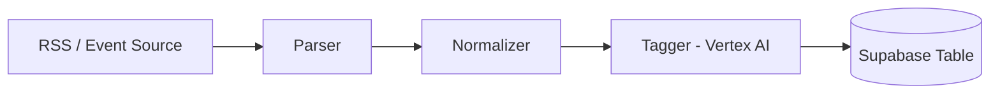

# Debut Crawler

기술 블로그 RSS/개발 이벤트 데이터를 수집해서 Supabase에 적재하는 모듈입니다.

## 수집 파이프라인



## 실행 전 준비

```bash
cd crawler
cp .env.example .env
uv sync
```

## 실행 명령

### Tech Blog 수집

```bash
uv run python -m src.apps.tech_blog.cli
```

### Dev Event 수집

```bash
uv run python -m src.apps.dev_event.cli
```

GitHub Dev-Event README를 파싱한 뒤, 상세 페이지는 **Firecrawl + Vertex AI**로 심층 크롤링합니다(`FIRECRAWL_API_KEY` 설정 시).

기본값은 상세가 없는 활동을 모두 수집합니다. `--limit 20`은 목록 개수가 아니라 **상세 수집 시도 횟수**를 제한합니다. 목록과 날짜는 전부 저장하고, 상세는 한 건씩 즉시 저장합니다. 재실행하면 이미 요약이 있는 활동은 건너뜁니다. 원문에 없는 비용·혜택 등은 비워 두며, 수집 실패 항목은 다음 실행에서 재시도합니다. 원문에서 빠진 활동은 삭제하지 않고 마감 처리합니다.

웹의 최신순은 접수 시작일(접수 기간이 없으면 행사일), 종료일, ID 순입니다. README 섹션의 연도를 함께 저장하므로 같은 날 일괄 등록한 활동도 날짜순으로 표시됩니다.

### 레거시 중복 정리

먼저 별칭 조회가 포함된 웹 코드를 배포한 뒤 실행합니다. 가장 오래된 ID에 상세 데이터를 합치고, 다른 ID는 별칭으로 남겨 기존 상세 링크를 보존합니다. 팀 모집의 활동 ID도 함께 옮깁니다.

```bash
uv run --group maintenance python -m src.apps.dev_event.reconcile          # 읽기 전용 계획
uv run --group maintenance python -m src.apps.dev_event.reconcile --check  # SQL 검증 후 롤백
uv run --group maintenance python -m src.apps.dev_event.reconcile --apply  # 실제 적용
```

`DATABASE_URL`이 필요합니다. 적용·검증 전에 `.runlogs/dev-event-backups/`에 전체 활동과 관련 ID를 백업합니다. 예기치 않은 외래 키가 있으면 중단하며, 병합과 고유 인덱스 생성은 한 트랜잭션으로 처리합니다. 백업에는 DB 데이터가 있으므로 커밋하지 않습니다.

검증: `uv run python -m unittest discover -s tests -v`

### GitHub Actions

`.github/workflows/crawler.yml`이 매일 03:15(KST)에 두 크롤러를 실행합니다. GitHub Actions의 Repository Secrets에 `NEXT_PUBLIC_SUPABASE_URL`, `SUPABASE_SERVICE_ROLE_KEY`, `GOOGLE_CLOUD_PROJECT`, `GOOGLE_SERVICE_ACCOUNT_JSON_B64`를 등록해야 합니다. `GOOGLE_CLOUD_LOCATION`은 선택값이며 기본값은 `us-central1`입니다. `FIRECRAWL_API_KEY`는 개발자 행사 상세 크롤링에 필요합니다. `workflow_dispatch`로 특정 크롤러만 수동 실행할 수도 있습니다.

## 주요 환경변수

| 키 | 필수 | 설명 |
|---|---|---|
| `NEXT_PUBLIC_SUPABASE_URL` | 필수 | Supabase 연결 |
| `SUPABASE_SERVICE_ROLE_KEY` | 필수 | Supabase 쓰기 권한 |
| `GOOGLE_GENAI_USE_VERTEXAI` | 필수 | `true`로 Vertex AI 사용 |
| `GOOGLE_CLOUD_PROJECT` | 필수 | Vertex AI GCP 프로젝트 ID |
| `GOOGLE_CLOUD_LOCATION` | 선택 | Vertex AI 리전, 기본 `us-central1` |
| `GOOGLE_SERVICE_ACCOUNT_JSON_B64` | 필수 | Vertex AI 서비스 계정 JSON의 base64 값 |
| `FIRECRAWL_API_KEY` | 선택 | dev_event 상세 페이지 심층 크롤링 시 |
| `SUPABASE_BLOGS_TABLE` | 선택 | 테이블명 커스텀 |
