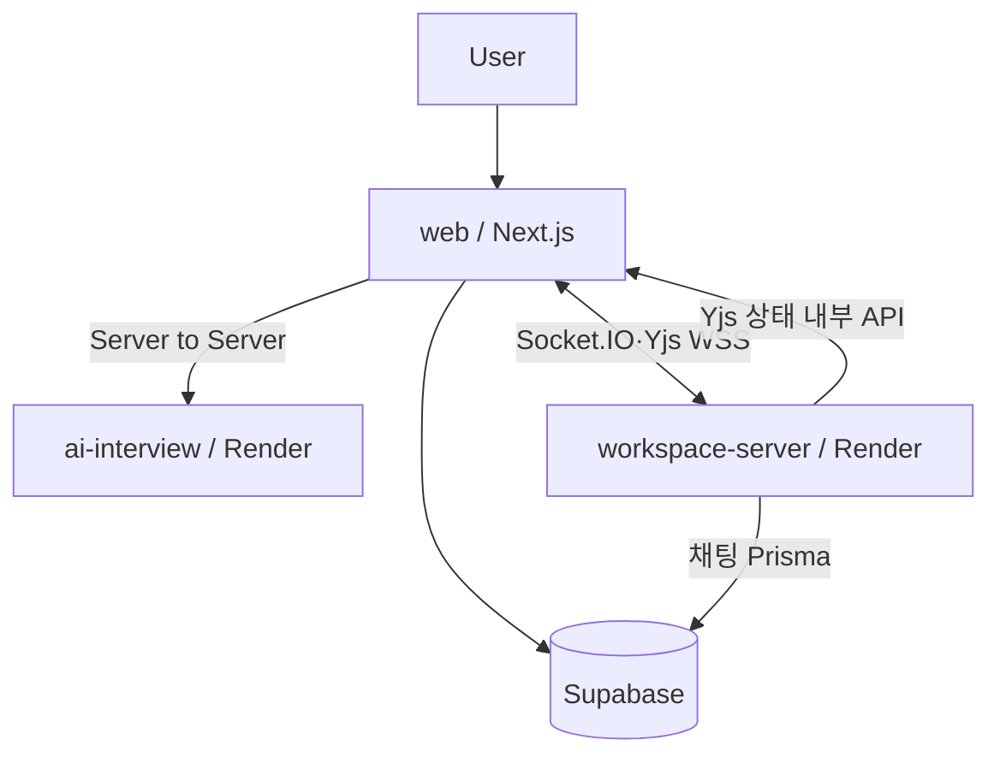

# Debut Web (Next.js)

사용자에게 보이는 메인 프론트엔드입니다.

- AI 면접 UI
- 워크스페이스 UI
- 커뮤니티/채용/기술블로그
- 커리어 문서 스튜디오 (이력서·자소서·포트폴리오)
- BFF API (`app/api/*`)

> 제품의 현재 구조와 운영 기준은 [프로젝트 기준 문서](../docs/PROJECT_REFERENCE.md)를 참조합니다. 이 앱은 단순 중계가 아니라 사용자 UI와 BFF API를 함께 담당합니다.

## 화면-서버 연결 그림



## 폴더 구조 (요약)

- `app/`: App Router 페이지
- `app/api/`: BFF API
- `components/features/`: 도메인별 UI
- `hooks/`: 실시간/인터뷰 훅
- `store/`: Zustand 상태
- `lib/`: 서버 액션/유틸

## 환경변수

### 공통(필수)

| 키                              | 설명                  |
| ------------------------------- | --------------------- |
| `NEXT_PUBLIC_SUPABASE_URL`      | Supabase 프로젝트 URL |
| `NEXT_PUBLIC_SUPABASE_ANON_KEY` | Supabase anon key     |
| `SUPABASE_SERVICE_ROLE_KEY`     | 서버 라우트용 key     |

### AI 면접 연동

| 키                              | 예시                                                  |
| ------------------------------- | ----------------------------------------------------- |
| `AI_INTERVIEW_BASE_URL`         | `https://<ai-interview-service>`                      |
| `NEXT_PUBLIC_AI_WS_URL`         | `wss://<ai-interview-service>/v1/interview/ws/client` |
| `NEXT_PUBLIC_AI_ADMIN_BASE_URL` | `https://<ai-interview-service>/admin`                |

### 워크스페이스 연동

| 키                          | 실행 위치 | 예시/설명                                                   |
| --------------------------- | --------- | ----------------------------------------------------------- |
| `NEXT_PUBLIC_WS_URL`        | 브라우저  | Socket.IO 주소. 로컬 `ws://localhost:4000`                  |
| `NEXT_PUBLIC_SOCKET_URL`    | 브라우저  | 화이트보드 Yjs 주소. 현재 위 값과 동일                      |
| `INTERNAL_API_SECRET`       | BFF 서버  | workspace-server와 동일한 긴 랜덤 값                        |

워크스페이스 기능의 역할 경계:

- 보드·태스크·일정·멤버·문서 메타데이터·댓글·자산: `app/api/workspaces/**`
- 작업 메뉴는 워크스페이스의 단일 보드로 바로 진입한다. 목록·칸반·일간/주간/월간 타임라인과 그룹·필터의 상세 동작 기준은 [`specs/workspace/board.md`](../specs/workspace/board.md)를 따른다.
- 문서 편집·저장: `app/api/workspaces/[id]/docs/**`
- Yjs 화이트보드 상태 내부 API: `app/api/workspaces/[id]/whiteboard`
- 채팅·화이트보드 실시간 전송: `workspace-server`

세부 이벤트와 저장 흐름은 [workspace-server 코드 인수인계](../workspace-server/HANDOVER.md)를 참조합니다.

### LiveKit 사용 시

| 키                             | 설명                  |
| ------------------------------ | --------------------- |
| `NEXT_PUBLIC_LIVEKIT_URL`      | LiveKit URL           |
| `LIVEKIT_API_KEY`              | 서버 토큰 발급 키     |
| `LIVEKIT_API_SECRET`           | 서버 토큰 발급 시크릿 |
| `LIVEKIT_API_KEY_WORKSPACE`    | 워크스페이스용(선택)  |
| `LIVEKIT_API_SECRET_WORKSPACE` | 워크스페이스용(선택)  |

## 로컬 실행

```bash
cd web
cp .env.example .env.local
npm install
npm run dev
```

`npm run dev`와 `npm run build`는 실행 전에 현재 스키마로 Prisma Client를
자동 생성합니다. 스키마 변경을 가져온 뒤 이미 실행 중인 개발 서버는 다시
시작해야 서버 메모리에 남은 이전 Prisma Client도 교체됩니다.

## 배포

### Vercel 권장

1. GitHub 연결
2. Root Directory `web` 지정
3. 위 환경변수 입력
4. Deploy

## 주요 스크립트

```bash
npm run dev
npm run build
npm run start
npm run lint
```

## 면접 콘솔 모범답변

면접 화면에서 개발자 도구(F12)의 Console에 입력합니다. 새로고침·화면 이동 후에는 다시 켜야 합니다.

```js
interviewCoach.start()   // 현재 질문과 이후 질문에 자동으로 모범답변 출력
interviewCoach.answer()  // 현재 질문만 요청 (자동 출력은 켜지 않음)
interviewCoach.stop()    // 자동 출력 중지 및 진행 중 요청 취소
```

공고 면접은 해당 세션의 공고·이력서와 공고에 연결한 자소서·프로젝트·포트폴리오를, 직무 면접은 선택 직무를, 디펜스는 저장된 GitHub 분석 자료를 반영합니다. 연결 자료는 공고에서 면접을 새로 시작할 때 세션에 전달됩니다. 답변은 한국어 2~4문장, 최대 360자이며 대화·평가 기록에 저장되지 않습니다.

`POST /api/interview/sessions/[id]/model-answer`는 `{ question: string }`을 받아 본인 소유 세션과 자료를 조회하고 `{ success: true, data: { answer } }`를 반환합니다. 생성에는 Gemini 2.5 Flash(추론 끄기)를 사용하고, 생성 대기는 20초로 제한합니다.

```bash
npx tsx --test lib/interview/console-coaching.test.ts lib/interview/model-answer*.test.ts
```
